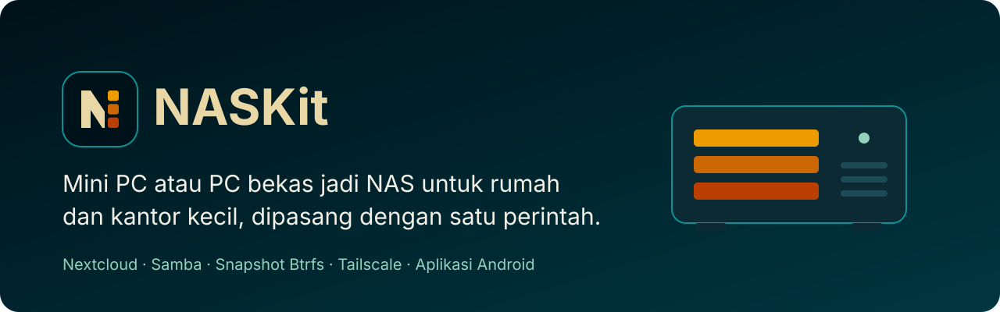
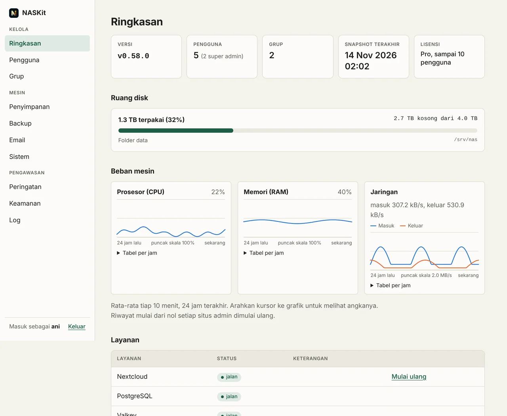
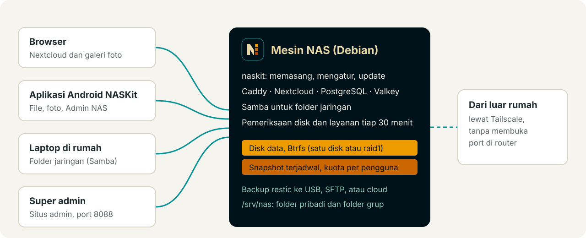
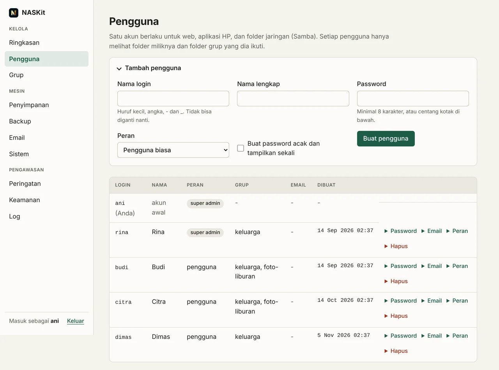
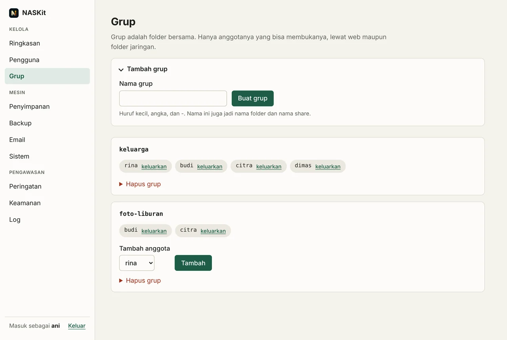
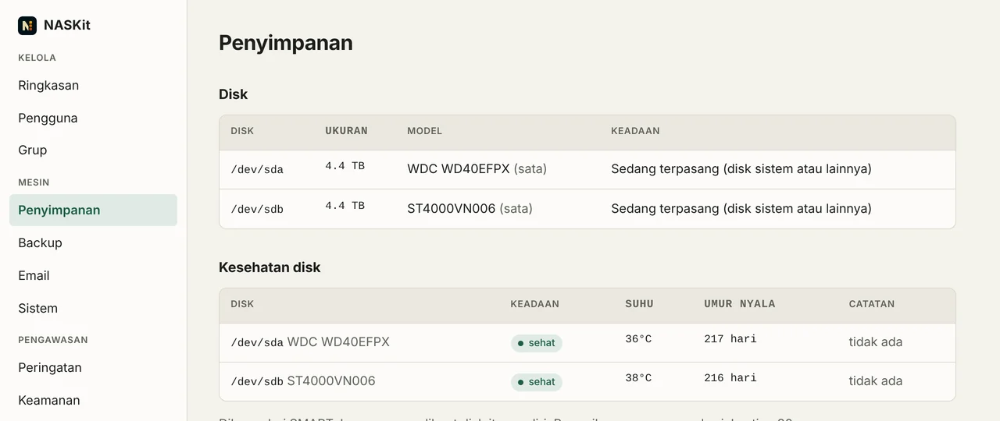
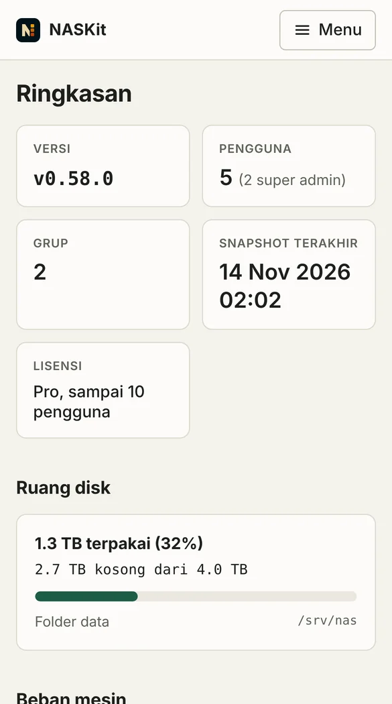
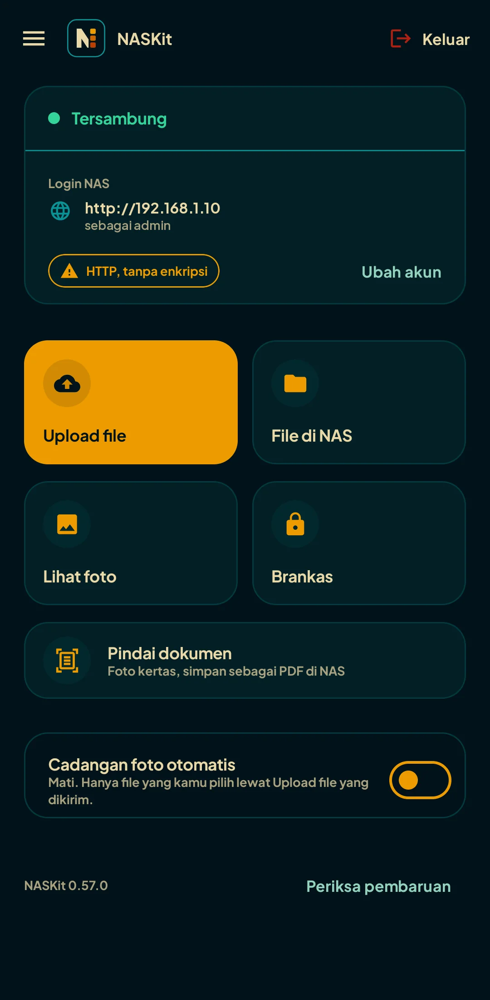
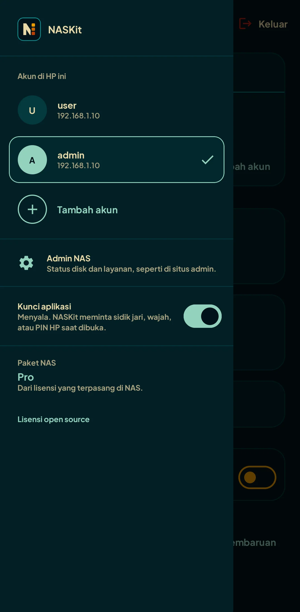

<p align="center">
  
</p>

<p align="center">
  <a href="https://github.com/anggaaaaaaaaaaar/naskit-release/releases/latest"></a>
  
  
  <a href="LISENSI.md"></a>
</p>

<p align="center">
  <a href="#fitur">Fitur</a> ·
  <a href="#gratis-dan-pro">Gratis dan Pro</a> ·
  <a href="#pasang">Pasang</a> ·
  <a href="#aplikasi-android">Aplikasi Android</a> ·
  <a href="#update">Update</a> ·
  <a href="#lisensi">Lisensi</a>
</p>

NASKit mengubah mini PC atau PC bekas menjadi NAS untuk rumah, keluarga,
atau kantor kecil. Setiap pengguna punya folder pribadi, dan file bisa
dibuka dari browser, aplikasi Android NASKit, jaringan lokal (Samba), atau
dari luar rumah lewat Tailscale tanpa membuka port di router.

Repo ini hanya berisi file rilis. Source code NASKit tidak publik.

<p align="center">
  
</p>

## Fitur

`naskit` adalah satu program untuk Linux amd64 dan arm64. Program ini
memasang dan mengatur Nextcloud, PostgreSQL, Valkey, Caddy, dan Samba di
Docker, lalu menyediakan situs admin di port 8088.

<p align="center">
  
</p>

### Satu akun untuk web, HP, dan folder jaringan

Pengguna dibuat sekali, lalu bisa masuk ke Nextcloud di browser, ke
aplikasi Android, dan ke folder Samba dengan nama dan password yang sama.
Folder grup dipakai bersama oleh anggotanya.

<p align="center">
  
</p>

<p align="center">
  
</p>

### Disk, snapshot, dan backup

- Disk data diformat Btrfs. Disk kedua bisa dipasang sebagai raid1 atau
  untuk menambah ruang; disk yang rusak bisa diganti.
- Kesehatan disk dibaca dari SMART: keadaan, suhu, dan umur nyala.
- Snapshot berjalan sesuai jadwal yang Anda pilih. File yang terhapus atau
  tertimpa bisa diambil lagi, oleh super admin lewat
  `naskit snapshot restore`, atau oleh pengguna sendiri dari aplikasi
  Android untuk Folder Saya.
- Kalau ruang tinggal sedikit, snapshot paling lama dihapus lebih dulu.
- Backup restic ke USB, SFTP, atau cloud, dengan uji restore mingguan.

<p align="center">
  
</p>

### Pemeriksaan dan peringatan

Tiap 30 menit NAS memeriksa SMART, galat Btrfs, ruang kosong, backup, dan
semua layanan. Masalah tampil di halaman Peringatan dan bisa dikirim lewat
Telegram, email, atau notifikasi di HP super admin. Layanan yang macet bisa
dimulai ulang dari halaman Ringkasan.

### Keamanan

Login dua langkah (2FA) dengan kode pemulihan, lupa password lewat email,
log aktivitas admin dan pengguna, dan daftar perangkat yang masuk ke tiap
akun. Perangkat yang hilang bisa dikeluarkan dari situs admin.

### Bisa dibuka dari HP

Situs admin menyesuaikan diri dengan layar HP. Aplikasi Android juga punya
menu Admin NAS untuk super admin, dengan isi yang sama seperti situs admin.

<p align="center">
  
</p>

Gambar di atas diambil dari situs admin versi terbaru dengan data contoh.

## Gratis dan Pro

NASKit bisa dipakai tanpa kunci lisensi, gratis dan tanpa batas waktu.

| | Gratis | Pro |
|---|---|---|
| Pengguna terkelola (super admin awal tidak dihitung) | 1 | sesuai kunci |
| Nextcloud, Samba, aplikasi Android, 2FA, log aktivitas | ya | ya |
| Peringatan di situs admin, kesehatan disk, grafik | ya | ya |
| Peringatan lewat Telegram, email, dan notifikasi HP | tidak | ya |
| Kuota per pengguna | tidak | ya |
| Folder grup | tidak | ya |
| Backup ke luar NAS (restic) | tidak | ya |
| Tambah dan ganti disk, pasang update, masuk Tailscale | lewat command line | juga dari situs admin dan aplikasi |
| Snapshot yang disimpan | sampai 24 per jam dan 7 harian | sampai 72 per jam, 60 harian, 52 mingguan, 24 bulanan |
| Aplikasi: tempat sampah, zip, putar video, simpan offline, cadangan kamera, scanner dokumen, analisis penyimpanan | tidak | ya |

Kunci Pro dibeli per mesin. Jalankan `naskit license machine-id` di NAS,
kirim hasilnya ke penjual, lalu pasang kunci yang Anda terima:

```sh
sudo naskit license install <kunci>
naskit license status
```

Kunci dicek secara offline. Kalau kunci habis atau dicabut, file Anda
tidak ikut terkunci. Pengguna, grup, dan backup lama tetap jalan; yang
berhenti hanya fitur Pro untuk hal baru serta backup dan notifikasi
terjadwal.

## Kebutuhan

- Debian atau Ubuntu 64-bit (amd64 atau arm64), dengan akses root.
- RAM minimal 4 GB. Untuk sampai 10 pengguna, 8 sampai 16 GB lebih nyaman.
- Satu disk sistem dan minimal satu disk data. Disk data diformat Btrfs
  oleh `naskit storage init`, jadi isinya akan dihapus.

## Pasang

Cara paling cepat:

```sh
curl -fsSL https://github.com/anggaaaaaaaaaaar/naskit-release/releases/latest/download/install.sh | sudo sh
```

Installer ini memilih build yang cocok dengan CPU, mencocokkan checksum
SHA-256 dengan `checksums.txt`, memasang `/usr/local/bin/naskit`, memasang
Docker, Samba, btrfs-progs, smartmontools, restic, dan Tailscale kalau
belum ada, lalu menjalankan `naskit install`. Kalau checksum tidak cocok,
instalasi dibatalkan.

Pilihan lewat variabel lingkungan:

| Variabel | Fungsi |
|---|---|
| `NASKIT_VERSION=v0.58.0` | pasang versi tertentu, bukan yang terbaru |
| `NASKIT_NO_INSTALL=1` | hanya pasang program, jangan jalankan `naskit install` |
| `NASKIT_NO_DOCKER=1` | jangan pasang Docker otomatis |

Kalau ingin membaca installer sebelum menjalankannya:

```sh
curl -fsSLO https://github.com/anggaaaaaaaaaaar/naskit-release/releases/latest/download/install.sh
less install.sh
sudo NASKIT_VERSION=v0.58.0 sh install.sh
```

### Unduh dan cek sendiri

Rilis untuk NAS di halaman [Releases](https://github.com/anggaaaaaaaaaaar/naskit-release/releases)
berisi:

- `naskit_<versi>_linux_amd64.tar.gz` dan `naskit_<versi>_linux_arm64.tar.gz`,
  isinya `naskit`, `CHANGELOG.md`, dan file lisensi;
- `checksums.txt`, berisi SHA-256 kedua arsip;
- `install.sh` dan `revoked.txt` (daftar kunci lisensi yang dicabut).

Unduh arsip untuk CPU Anda dan `checksums.txt` dari rilis yang sama, lalu
cek. Ganti `amd64` dengan `arm64` untuk mesin ARM.

```sh
V=0.58.0
curl -fsSLO https://github.com/anggaaaaaaaaaaar/naskit-release/releases/download/v$V/naskit_${V}_linux_amd64.tar.gz
curl -fsSLO https://github.com/anggaaaaaaaaaaar/naskit-release/releases/download/v$V/checksums.txt
sha256sum -c --ignore-missing checksums.txt
```

Hasilnya harus `naskit_0.58.0_linux_amd64.tar.gz: OK`. Kalau tertulis
`FAILED`, jangan pakai arsip itu. Setelah itu:

```sh
tar -xzf naskit_${V}_linux_amd64.tar.gz
sudo install -m 0755 naskit /usr/local/bin/naskit
sudo naskit install
```

Cara manual ini tidak memasang Docker dan paket lain. Pasang Docker beserta
plugin compose lebih dulu, atau pakai `install.sh`.

## Setelah terpasang

```sh
sudo naskit storage list              # disk yang belum dipakai
sudo naskit storage init /dev/sdb     # disk data pertama, dipasang di /srv/nas
sudo naskit user add budi             # pengguna baru, ditanya password
```

Lalu buka `https://<alamat NAS>:8088` dan masuk dengan akun super admin.
Sertifikatnya self-signed, jadi browser akan memberi peringatan sekali.
Jangan buka port 8088 dan 445 di router. Untuk akses dari luar, pakai
Tailscale.

Konfigurasi ada di `/opt/naskit`, file pengguna di `/srv/nas`.

## Aplikasi Android

APK ada di rilis yang memuat perubahan aplikasi, dengan nama
`naskit-android_<versi>.apk` dan file `.sha256` di sebelahnya. Buka
[Releases](https://github.com/anggaaaaaaaaaaar/naskit-release/releases),
unduh APK terbaru ke HP, lalu izinkan pemasangan dari sumber tersebut saat
Android memintanya. Setelah terpasang, aplikasi mengecek versi baru dari
repo ini sendiri.

Isinya:

- Kelola file di Folder Saya dan folder grup: upload, unduh, pindah,
  salin, ganti nama, cari, favorit, riwayat versi, dan pulihkan dari
  snapshot.
- Galeri foto dan video per hari, dengan filter dan info lokasi.
- Berbagi lewat link (password dan masa berlaku opsional) atau ke
  pengguna NAS lain.
- Kunci aplikasi dan Brankas Aman yang dienkripsi di HP.
- Admin NAS untuk super admin: pengguna, grup, penyimpanan, backup,
  peringatan, email, sistem, dan keamanan.

Untuk masuk, isi alamat NAS (di rumah, atau `http://100.x.y.z` lewat
Tailscale), nama pengguna, dan password yang sama dengan Nextcloud.

<p align="center">
  
  &nbsp;
  
</p>

Kiri: beranda setelah masuk. Kanan: menu samping, tempat pindah akun,
membuka Admin NAS, dan menyalakan kunci aplikasi. Diambil dari versi
0.57.0; alamat dan nama pengguna di gambar sudah diganti contoh.

## Update

```sh
naskit update --check    # ada versi baru?
sudo naskit update       # pasang; program lama disimpan sebagai naskit.prev
sudo naskit rollback     # kembali ke versi sebelumnya
```

`naskit update` mengambil rilis dari repo ini dan mengecek `checksums.txt`
yang sama. Rilis dengan akhiran seperti `v0.16.0-rc.1` adalah pre-release
dan hanya dipasang kalau diminta dengan `--to`.

Catatan perubahan tiap versi ada di halaman rilis dan di `CHANGELOG.md` di
dalam arsip rilis.

## Lisensi

NASKit bukan open source. Ketentuan pemakaian, aturan kunci lisensi, data
apa saja yang dikirim NASKit ke internet, dan lisensi program pihak ketiga
(Nextcloud, Samba, pustaka aplikasi Android, dan lainnya) ada di:

- [LISENSI.md](LISENSI.md), bahasa Indonesia
- [LICENSE.md](LICENSE.md), bahasa Inggris

Keduanya berlaku sama. Kalau ada perbedaan arti, yang dipakai versi bahasa
Indonesia. Lisensi ini tunduk pada hukum Republik Indonesia.

## In English

NASKit turns a mini PC or an old PC into a NAS for a home or small office:
a private folder per user, shared group folders, and access from the
browser, the NASKit Android app, the LAN (Samba) and Tailscale. This
repository only holds release files; the source is private. Install with
the `install.sh` command above, or download an archive and `checksums.txt`
from Releases and run `sha256sum -c --ignore-missing checksums.txt` before
using it. The Android APK is attached to releases that change the app. The
free plan needs no key; Pro keys are sold per machine. The terms are in
[LICENSE.md](LICENSE.md).
